<!-- kluuuzy@nowhere :: profile README
     the header needs ./assets/banner.svg committed in this same repo -->

<p align="center">
  
</p>

<p align="center">
  
</p>

<p align="center">
  <a href="https://www.linkedin.com/in/earl-ledesma"></a>
  <a href="https://tryhackme.com/p/Kluuutzy"></a>
  
</p>

## `~/whoami`

```console
kluuuzy@nowhere:~$ whoami --verbose
name    : Earl Ledesma
handle  : Kluuuzy
role    : aspiring cybersecurity professional · CTF player · web developer
aim     : SOC analyst · offensive security
study   : BS Information Technology — University of St. La Salle
work    : cybersecurity intern @ Cryptonic Area
org     : UI/UX officer @ Google Developer Groups on Campus – USLS
```

## `~/loot`

```console
kluuuzy@nowhere:~$ cat trophies.log
[🏆] Hack4Gov 2026 .............................. NIR Regional Champion
[🥈] QCSP CTF (QCS × ISC2) ...................... 1st Runner-Up
[🔥] TryHackMe .................................. 90-day streak completed
```

## `~/focus`

```console
kluuuzy@nowhere:~$ tree ~/focus
~/focus
├── offensive/
│   ├── vulnerability-assessment
│   ├── pentest-fundamentals
│   ├── recon-and-enumeration
│   └── osint
├── defensive/
│   ├── siem-monitoring
│   ├── security-log-analysis
│   ├── endpoint-monitoring
│   └── linux-hardening
└── network/
    ├── network-analysis
    ├── firewall-configuration
    └── network-security

3 directories, 11 files
```

## `~/arsenal`

| module | loaded |
|:--|:--|
| `security` |     |
| `systems` |   |
| `network` |    |
| `languages` |         |
| `build` |       |
| `design` |  wireframing · prototyping |

## `~/projects`

<!-- once a repo is public, turn its name into a link:  [`wazuh-home-lab/`](https://github.com/Kluuuzy/REPO-NAME) -->

| dir | what's inside |
|:--|:--|
| `wazuh-home-lab/` | SIEM deployment with Linux + Windows endpoints — log monitoring, File Integrity Monitoring (FIM), Security Configuration Assessment (SCA) |
| `vuln-assessment-tool/` | Vulnerability assessment workflow with documented security findings |
| `hardened-plex-server/` | Linux media server, locked down — firewall rules, SSH protection, Fail2Ban |
| `vulnerable-php-app/` | PHP/MySQL web app built with a database backend, then security-tested |
| `packet-tracer-lab/` | Network topology design — switching, routing, connectivity |
| `openclaw-ollama-assistant/` | Local cybersecurity AI assistant running on a self-hosted LLM |
| `flutter-mp3-player/` | Lightweight local music player in Flutter/Dart |

## `/etc/certs`

```console
kluuuzy@nowhere:~$ cat /etc/certs
CISCO      CCNA: Introduction to Networks
           Introduction to Cybersecurity
           Ethical Hacker
FORTINET   Certified Associate in Cybersecurity (FCA)
           Certified Fundamentals in Cybersecurity (FCF)
GOOGLE     Cybersecurity Professional Certificate
ISO/IEC    27001 Information Security Associate
COURSERA   Network Security
```

## `~/stats`

<p align="center">
  <a href="https://tryhackme.com/p/Kluuutzy"></a>
</p>

<p align="center">
  
</p>

<p align="center">
  
</p>

```console
kluuuzy@nowhere:~$ exit
logout
Connection to nowhere closed.
```